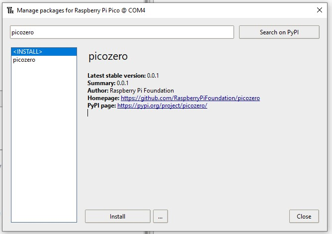

## 1A - Connect and test your Pico

Everyone does this first. The starter checks the board before you choose any alarm parts.

## Step 1

> [!TASK]
>
> Download the [starter project](resources/alarm.py). Open it in Thonny and **save your own copy** as `alarm.py`.

## Step 2

> [!TASK]
>
> Connect your Pico with a USB **data** cable. In Thonny choose **MicroPython (Raspberry Pi Pico)** as the interpreter.
>
> 
>
> 

## Step 3

> [!TASK]
>
> Run your starter. Its first test is:
>
> ```python
> from picozero import pico_led
> from time import sleep
>
> pico_led.on()
> sleep(1)
> pico_led.off()
> print("Pico and picozero are ready")
> ```

## Test

> [!TASK]
>
> Did the onboard LED light for one second? Did the Shell show **Pico and picozero are ready**? Keep your saved starter for the alarm you make.

> [!TIP]
>
> If Thonny cannot find the Pico, check the USB data cable and interpreter. If it says `No module named picozero`, install **picozero** through **Tools → Manage packages**.
>
> 

Choose a case, input, warning or rule next. You can change direction later.
