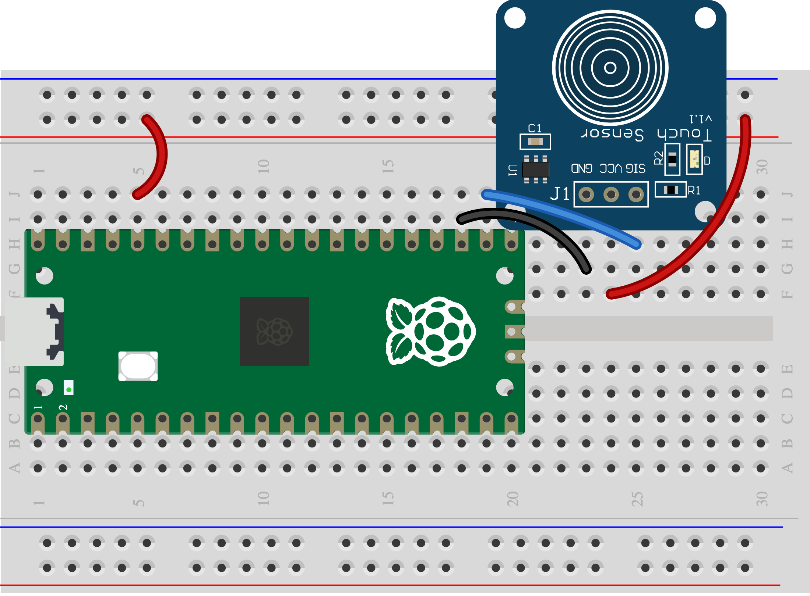

## 3B - Touch a pad

A light touch can trigger a secret alarm.

> [!CAUTION]
>
> First complete [1A - Connect and test your Pico](1A%20-%20Connect%20and%20test%20your%20Pico.md). You can explore this idea before wiring it.

## Step 1

> [!TASK]
>
> Gather a TTP223 touch module and three leads.
>
> SIG goes to GP17, VCC to 3V3 OUT, and GND to GND.
>
> 

## Step 2

> [!TASK]
>
> Run the [Skills Bricks code](https://raspberrypifoundation.github.io/skills-bricks/capacitive-touch/capacitive-touch-pico.html) in Thonny:
>
> ```python
> from picozero import TouchSensor
>
> touch = TouchSensor(17)
>
> touched = touch.is_touched
> ```
>
> Add this underneath to see when the component detects an event:
>
> ```python
> print(touched)
> if touched:
>     print("Alarm trigger detected!")
> ```

## Test

> [!TASK]
>
> Touch and release the pad. A bare foil or thread contact uses the switch page instead. Change the number or reverse the `if` condition if your alarm needs the opposite action.

## Make it yours

Hide the pad behind thin card, then test that it still detects touch. When your test detects the event you want, [join it to a warning](6A%20-%20Join%20one%20input%20and%20warning.md).
