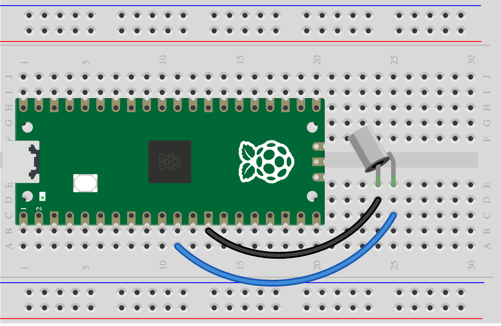

## 3D - Tilt switch

Detect a change in angle. A small ball inside the switch makes or breaks a contact.

> [!CAUTION]
>
> Have you [tested your Pico](1A%20-%20Connect%20and%20test%20your%20Pico.md)? Unplug it before wiring.

## Wire it

> [!TASK]
>
> Gather a ball tilt switch and two leads.
>
> Connect GP8 through the switch to GND.
>
> 

## Try the code

> [!TASK]
>
> Run the [Skills Bricks code](https://raspberrypifoundation.github.io/skills-bricks/tilt-switch/tilt-switch-pico.html) in Thonny:
>
> ```python
> from picozero import Switch
>
> tilt = Switch(8)
>
> tilted = tilt.is_open
> ```
>
> Add this to try a trigger. You can change the `if` line:
>
> ```python
> print(tilted)
> if tilted:
>     print("Alarm trigger detected!")
> ```

## Test

> [!TASK]
>
> Tip slowly and run again. Find the positions that give `True` and `False`; the reading may flicker while the ball rolls.

## Make it yours

Choose an angle that should trigger your alarm. Use `if tilted:` or `if not tilted:` to match it.

Ready? [Connect it to your chosen warning](6A%20-%20Connect%20your%20input%20and%20output.md).
