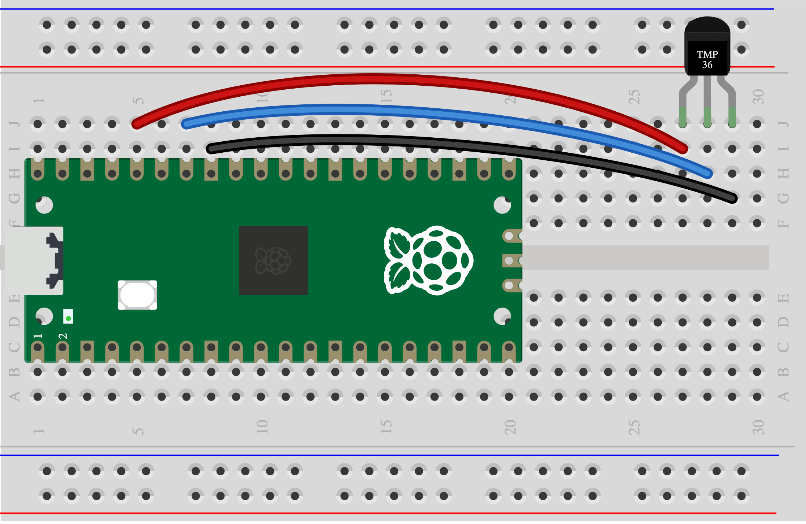

## 3I - Temperature sensor (TMP36)

Measure temperature in degrees Celsius with a TMP36 sensor.

> [!CAUTION]
>
> Have you [tested your Pico](1A%20-%20Connect%20and%20test%20your%20Pico.md)? Unplug it before wiring.

## Wire it

> [!TASK]
>
> Gather a TMP36 sensor and three leads.
>
> Flat face towards you: left to 3V3, centre to GP28, right to GND. Keep the legs apart.
>
> 

## Try the code

> [!TASK]
>
> Run the [Skills Bricks code](https://raspberrypifoundation.github.io/skills-bricks/temperature-sensor/temperature-sensor-pico.html) in Thonny:
>
> ```python
> from picozero import TemperatureSensor
>
> convert = lambda voltage: (voltage - 0.5) * 100
> sensor = TemperatureSensor(28, conversion=convert)
>
> temperature = sensor.temp
> ```
>
> Add this to try a trigger. You can change the `if` line:
>
> ```python
> print(temperature)
> if temperature > 25:
>     print("Alarm trigger detected!")
> ```

## Test

> [!TASK]
>
> Read the room temperature, then warm the sensor gently with your fingers and run again.

## Make it yours

Choose warmer or cooler as your trigger. Set a temperature you can reach in your test and use `>` or `<`.

Ready? [Connect it to your chosen warning](6A%20-%20Connect%20your%20input%20and%20output.md).
