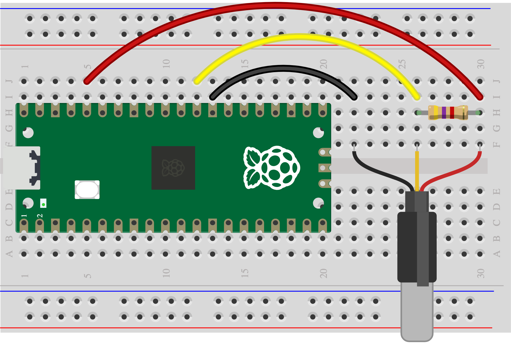

## 3J - Temperature probe (DS18B20)

Measure temperature in degrees Celsius with a DS18B20 probe.

> [!CAUTION]
>
> Have you [tested your Pico](1A%20-%20Connect%20and%20test%20your%20Pico.md)? Unplug it before wiring.

## Wire it

> [!TASK]
>
> Gather a sealed DS18B20 probe, a 4.7 kΩ resistor and leads.
>
> VDD goes to 3V3, DQ to GP22, GND to GND. Put 4.7 kΩ between DQ and 3V3. Check your probe’s wire colours.
>
> 

## Try the code

> [!TASK]
>
> Run the [Skills Bricks code](https://raspberrypifoundation.github.io/skills-bricks/temperature-probe/temperature-probe-pico.html) in Thonny:
>
> ```python
> from machine import Pin
> import onewire, ds18x20
> from time import sleep_ms
>
> bus = onewire.OneWire(Pin(22))
> sensor = ds18x20.DS18X20(bus)
> probes = sensor.scan()
> assert probes, "Check probe wiring"
> sensor.convert_temp()
> sleep_ms(750)
> temperature = sensor.read_temp(probes[0])
> print(temperature)
> ```
>
> Add this to try a trigger. You can change the `if` line:
>
> ```python
> if temperature > 25:
>     print("Alarm trigger detected!")
> ```

## Test

> [!TASK]
>
> Run again to get a new reading. Only a sealed, waterproof tip goes in water; keep the Pico and connections dry.

## Make it yours

Choose warmer or cooler as your trigger. Set your own temperature in the `if` line and allow time for the probe to change.

Ready? [Connect it to your chosen warning](6A%20-%20Join%20one%20input%20and%20warning.md).
