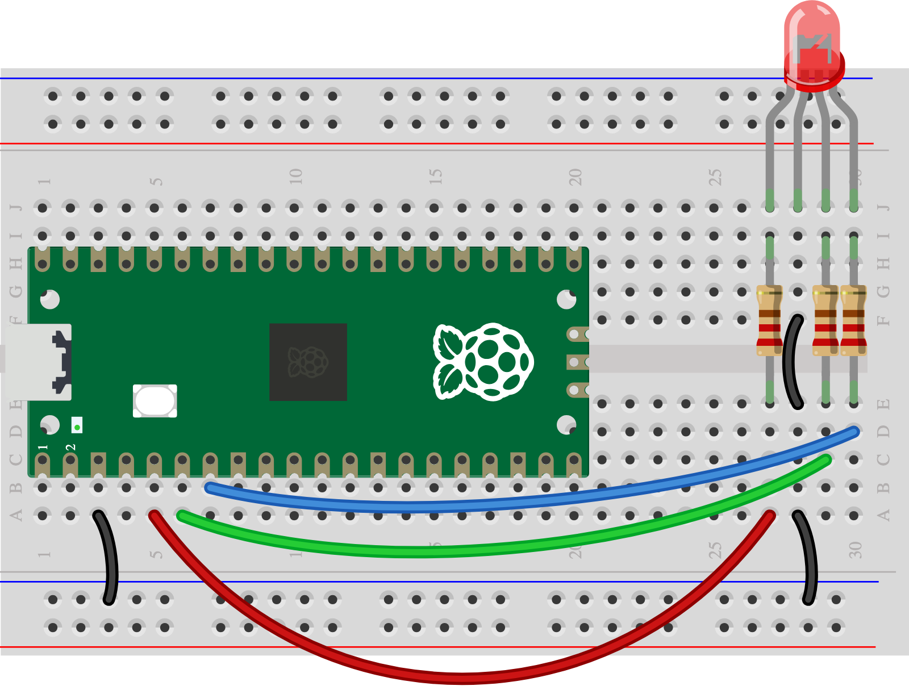

## 4B - Change warning colours

An RGB LED can show one colour for **ready** and another for **warning**.

> [!CAUTION]
>
> Have you completed [1A - Connect and test your Pico](1A%20-%20Connect%20and%20test%20your%20Pico.md)? Test the RGB LED alone before adding inputs. Use a common-cathode LED.

## Step 1

> [!TASK]
>
> Connect the R leg through **220 Ω to GP3**, G through **220 Ω to GP4**, B through **220 Ω to GP5**, and the common long leg to **GND**. Each colour needs its own resistor.
>
> 

## Step 2

> [!TASK]
>
> Try the [Skills Bricks RGB LED code](https://raspberrypifoundation.github.io/skills-bricks/rgb-led/rgb-led-pico.html):
>
> ```python
> from picozero import RGBLED
>
> light = RGBLED(red=3, green=4, blue=5)
>
> light.color = (255, 0, 255)
> ```
>
> Try `light.color = (0, 255, 0)` for ready and `(255, 0, 0)` for warning. Use `light.off()` to switch it off.

## Test

> [!TASK]
>
> Can you make two colours that someone can tell apart? Put a label or shape beside the light so colour is not the only clue.
