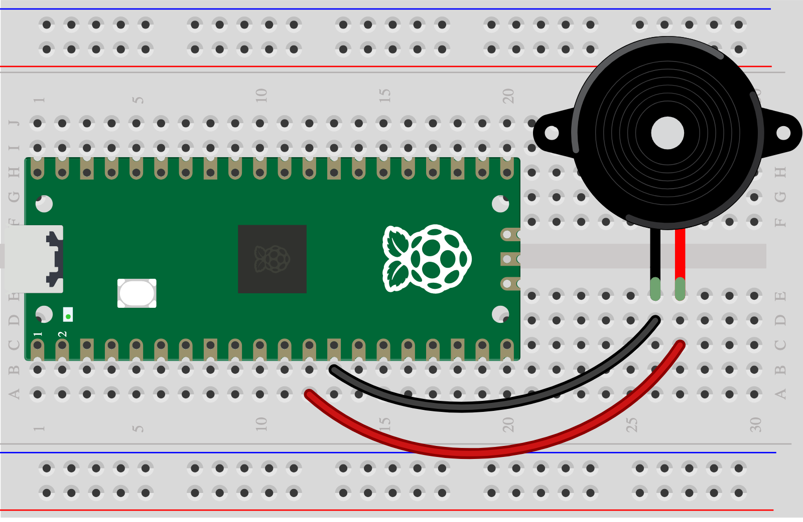

## 4D - Passive buzzer

A **passive** buzzer can change pitch. Check the packet for *passive* or *external drive*; it can look like an active buzzer.

> [!CAUTION]
>
> Have you completed [1A - Connect and test your Pico](1A%20-%20Connect%20and%20test%20your%20Pico.md)? Use one small **3.3 V GPIO-compatible** piezo buzzer on GP9 at a time.

## Wire it

> [!TASK]
>
> Connect buzzer **+ → GP9** and **− → GND**.
>
> 

## Try the code

> [!TASK]
>
> Try the [Skills Bricks passive-buzzer code](https://raspberrypifoundation.github.io/skills-bricks/passive-buzzer/passive-buzzer-pico.html):
>
> ```python
> from picozero import PWMBuzzer
>
> # GP9, 2000 Hz, 50% duty
> buzzer = PWMBuzzer(9, 2000, 32768)
>
> buzzer.on()
> from time import sleep
> sleep(0.25)
> buzzer.off()
> ```
>
> Change `2000` to `1000` before running again to hear a different pitch.

## Test

> [!TASK]
>
> Did the pitch change? If not, check whether you have an [active buzzer](4C%20-%20Active%20buzzer.md). You can make a [new warning pattern](5C%20-%20Change%20the%20warning%20pattern.md).

Choose when it warns on the [Decide with code](6A%20-%20Connect%20your%20input%20and%20output.md) page.
