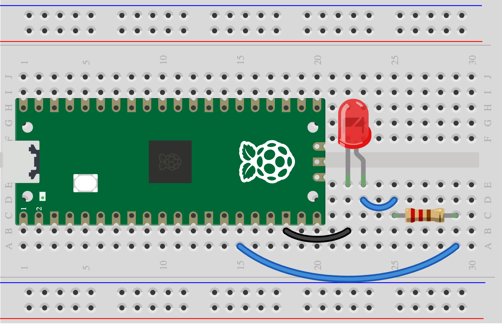

## 6A - Connect your input and output

Your input can detect a change. Your output can make a warning. **Now join their test scripts with a rule.**

> [!CAUTION]
>
> Have your [input and output](landing.md) both worked on their own? Revisit their tests if needed, or explore the code now.
>
> Unplug before joining circuits. Give each signal its own GP pin; the circuits can share GND.

## Join your scripts

Save copies of both tests. Make your combined program in `alarm.py`:

- **At the top:** keep the imports and component setup from both tests.
- **Inside `while True:`:** take a new input reading each time, including any conversion or wait lines.
- **Under your input’s `if` line:** replace the test message with your output’s warning command.
- **Under `else:`:** stop the warning. Add a short `sleep` so the loop pauses between checks.

Remove the output’s separate test run: your `if` and `else` now control it. Keep any pin numbers and settings you changed while testing.

<details>
<summary>See how two tests become one program: button + LED</summary>

### Keep both circuits

Button: GP10 to GND. LED: GP11 through a 220 Ω resistor to its long leg; short leg to GND.




### Join the code

The setup and reading come from the [button test](3A%20-%20Button%20or%20homemade%20switch.md). The warning commands come from the [LED test](4A%20-%20LED.md).

```python
# Imports from both tests
from picozero import Button, LED
from time import sleep

# Set up each component once
button = Button(10)
led = LED(11)

while True:
    # Read the input again each time
    pressed = button.is_pressed

    # Your rule connects input to output
    if pressed:
        led.on()
    else:
        led.off()

    sleep(0.05)
```

With your parts, keep their own setup, reading and warning commands in these positions. For an RGB LED, rename its `light` object to `warning` if your light sensor already uses `light` for a reading.

</details>

## Test

Trigger your input, then stop. Does the warning start and stop as you intended? If it warns at the wrong time, [change your trigger rule](5A%20-%20Choose%20what%20counts%20as%20a%20trigger.md).
