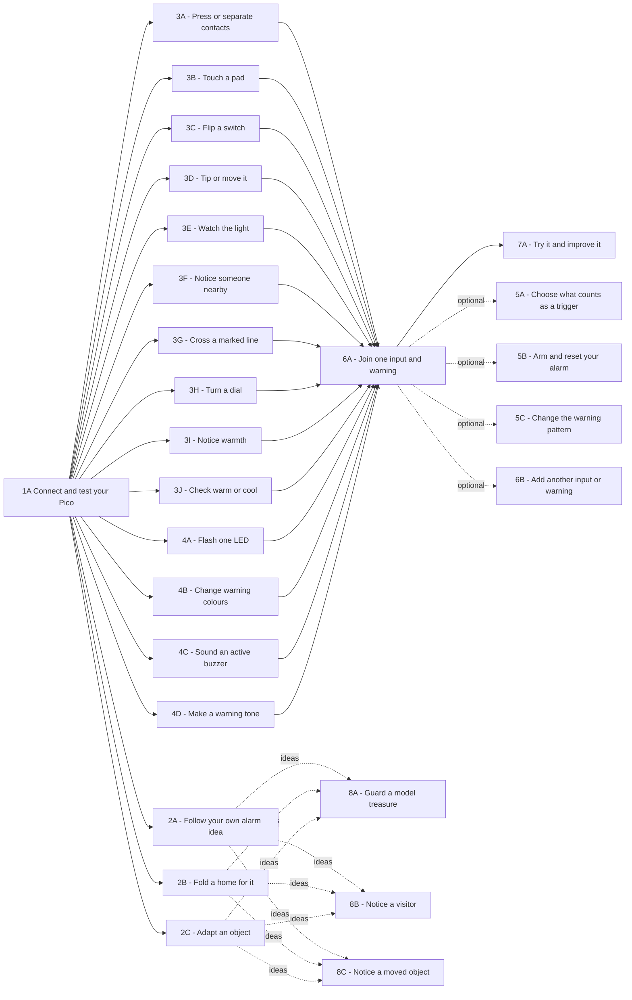

## Every page is a choice

Everyone starts at **1A**, where they open the starter, connect their Pico and test its LED. After that, the arrows show useful routes, not a fixed order. Choose a case, input, warning or rule; return to a prerequisite when a page asks. The three examples are optional ideas.

<!-- BEGIN GENERATED FLOWCHART -->

<!-- END GENERATED FLOWCHART -->

Try a body-first, input-first or warning-first route. To finish a first alarm, test one input and one warning, join them at **6A**, then improve it at **7A**.
